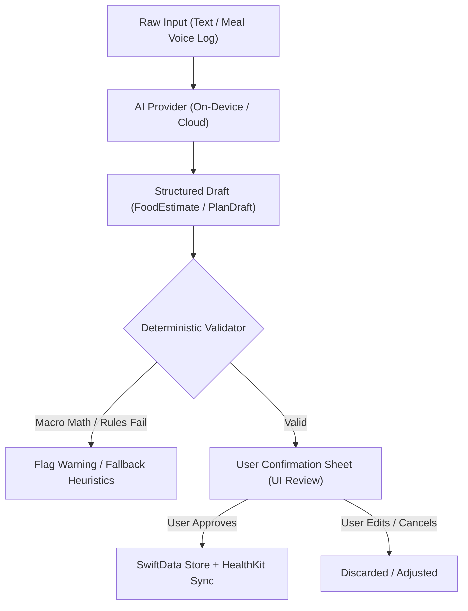

# 🍏 Orchard

> **Personal nutrition, supplement, sleep & energy balance iOS assistant tied dynamically to your workout schedule.**

Orchard is a single-user, offline-first iOS application built in Swift 6 / SwiftUI. It operates as a digital coach with a clipboard: knowing your schedule, nudging you at exact meal intervals, tracking calorie surplus/deficit against Apple Health workouts, and ending each day with a simple visual cue—an apple.

---

## 🏛️ Architecture & Philosophy

### 1. The 50/50 Split: Clock vs. Assistant
Orchard enforces a strict boundary between deterministic truth and AI assistance:
- **The Deterministic Core (The Clock):** Schedule resolution, notification scheduling, HealthKit calorie balance arithmetic, and streak calculations are pure, 100% testable Swift without network reliance.
- **The AI Layer (The Assistant):** Quick food logging via natural language, plan importing from plain text, and weekly narrative reviews.
- **The Golden Rule:**
  $$\text{AI Proposes} \longrightarrow \text{Deterministic Validator Checks} \longrightarrow \text{User Confirms} \longrightarrow \text{Persisted}$$



### 2. Pure Domain Layer
```
Orchard/
├─ App/                    # @main, DI container, app lifecycle, notification delegate setup
├─ Domain/                 # Pure Swift (zero UIKit/SwiftUI/HealthKit/UserNotifications)
│  ├─ Models/              # Plan, DayTemplate, PlanItem, Anchor, Rule, LogEntry, SleepEntry
│  ├─ ScheduleResolver.swift
│  ├─ NotificationPlanner.swift     # pure: events + logs + now -> [NotificationSpec]
│  ├─ CalorieEngine.swift
│  ├─ AppleProgress.swift
│  ├─ WeeklyStats.swift
│  └─ Validators/          # FoodEstimateValidator, PlanDraftValidator, AdjustmentValidator
├─ Services/               # Outside world integrations behind protocols
│  ├─ Notifications/       # UNUserNotificationCenter adapter + action handler
│  ├─ Health/              # HealthStore protocol + HealthKit implementation + Fake
│  ├─ Persistence/         # SwiftData stack, repositories, plan JSON loader
│  ├─ AI/                  # LLMProvider protocol + AppleOnDevice + Cloud + Mock
│  └─ Signing/             # ExpiryGuard (embedded.mobileprovision parsing)
├─ Features/               # SwiftUI modular screens (Today, Log, Insights, Plan, Settings)
├─ DesignSystem/           # Design tokens, AppleShape, haptics, typography
├─ Widget/                 # Interactive WidgetKit extension (App Intents)
├─ Resources/              # Localizable.xcstrings (Greek default, English secondary), plan.sample.json
└─ Tests/                  # Pure Swift unit tests & snapshot verification
```

### 3. Why Local Notifications?
Because Orchard is installed via a free Apple ID (7-day sideloading), there is no centralized APNs server. Local notifications provide:
- **Zero latency & 100% offline reliability:** Notifications fire on time even in airplane mode or during network outages.
- **Privacy:** Your daily schedule and habits never traverse an external push server.
- **Actionable Buttons:** `Done ✅`, `Snooze (+30m)`, and `Skip` are handled directly on lock-screen without launching the app.

---

## 🔒 Privacy & Open Source Safety

- **Real Meal Plan:** Stored in `plan.json` which is strictly ignored by `.gitignore`. The repository only contains `plan.sample.json`.
- **API Keys:** Cloud AI API keys (if enabled) reside solely in the local device Keychain and are entered at runtime in Settings.
- **HealthKit Writes:** Idempotent with unique sync identifiers (`orchard.<logEntryId>`). Orchard never writes active energy burned to prevent double-counting Apple Watch data.

---

## 🛠️ Build & Installation

### Prerequisites
- macOS Sonoma (14.0+) or newer
- Xcode 16.0+ (Swift 6.0+)
- [XcodeGen](https://github.com/yonaskolb/XcodeGen) (`brew install xcodegen`)

### Building the Project
1. **Clone the repository:**
   ```bash
   git clone https://github.com/skyd3n/orchard.git
   cd orchard
   ```
2. **Generate the Xcode Project:**
   ```bash
   xcodegen generate
   ```
3. **Run Unit Tests (SPM or Xcode):**
   ```bash
   swift test
   ```
4. **Open in Xcode:**
   ```bash
   open Orchard.xcodeproj
   ```
5. Select your personal development team under **Signing & Capabilities** and run on your physical iPhone.

---

## 📋 License
MIT License. See [LICENSE](file:///Users/john_ak/antigarvity/Orchard/LICENSE) for details.
