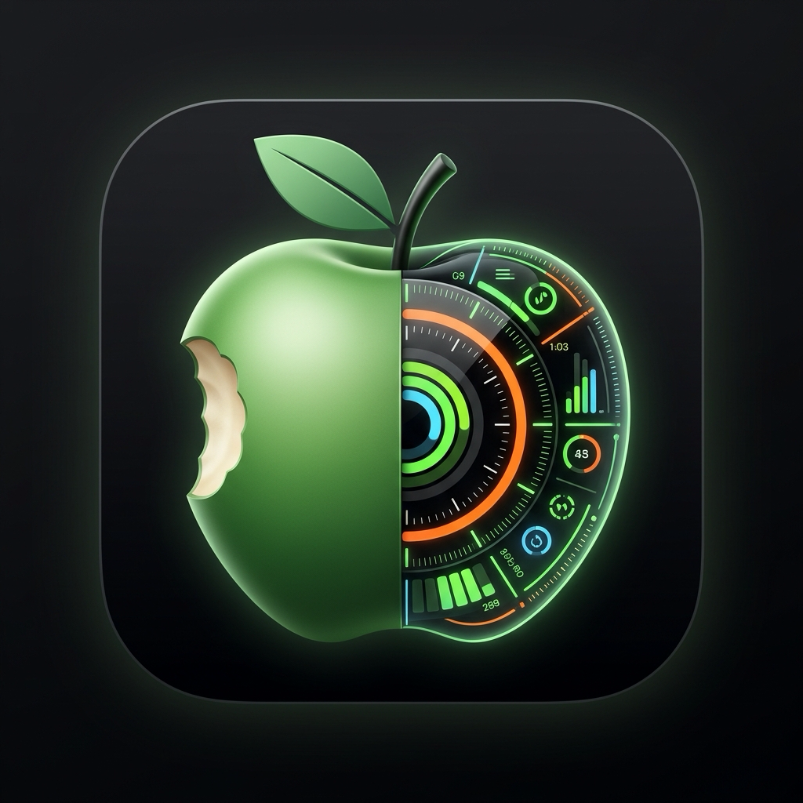
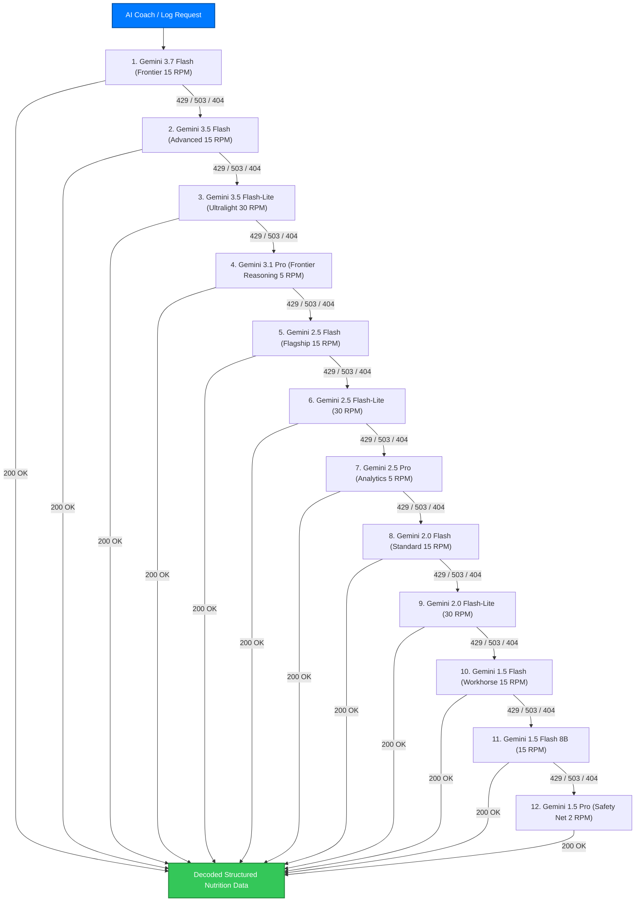

# 🍏 DIATROFIPROJECT (v2.0.0)

<p align="center">
  
</p>

<p align="center">
  <strong>Personal, Offline-First iOS Athletic Nutrition Rhythm, Live BYOK AI Coach, Modular Menu Picker, Multi-Session Scheduling & Wearable Recovery Assistant.</strong><br>
  <em>Tied dynamically to your training sessions, biological rhythms, and personalized nutrition protocols.</em>
</p>

<p align="center">
  
  
  
  
  
  
  
</p>

---

## 🎯 Executive Overview (v2.0.0)

**DIATROFIPROJECT** (also known as *The DIAτροφή Project* / code-named *Orchard*) is a production-grade, single-user, offline-first iOS application engineered for athletes who adhere to strict athletic nutrition plans, multi-session training schedules, and recovery protocols.

Unlike generic nutrition apps that operate as static calorie databases locked into rigid hourly slots, DIATROFIPROJECT operates on a **deterministic, rhythm-aware engine**:

* **Modular Menu-Picker Architecture (`PlanOption`):** Plan items can offer structured selection options (e.g. sandwiches, recovery tuppers, post-workout meals, garnishes, and oat omelets) with categorized details, individual macros, and instant 1-tap logging.
* **5 Dynamic Day Modes (`DayTemplate`):** Supports full daily rotation including **Training** (single session), **Double Training** (multi-session with independent session indexing), **Pre-Race (48h)** (low-residue pre-competition fueling), **Race Day** (competition fueling packet & immediate recovery), and **Rest** (dedicated active recovery targets).
* **Multi-Session Anchor Rippling:** Anchor resolution relative to workout blocks (`beforeTraining: 30m`, `afterTraining: 15m`, `afterWake: 90m`) using `sessionIndex: 0` and `sessionIndex: 1`. When training moves, the entire day's peri-workout meals, hydration, and supplements adjust without manual math.
* **Day-of-Week Supplement Filtering (`activeWeekdays`):** Fine-grained weekday scheduling (e.g. iron supplements scheduled exclusively on Wednesdays & Fridays) automatically filtered at the schedule resolver level.
* **Live BYOK AI Nutrition Coach (Gemini 12-Model Fallback):** Bring-Your-Own-Key (BYOK) conversational coach and instant food estimator. Injects full plan context into dynamic system prompts, deterministically hydrates macros (50/50 Physics/AI boundary), features an interactive Chat Sheet with 1-tap Confirm, optional Auto-Log, and complete multi-action Undo.
* **Athletic Hydration Engine (2.5L – 3.5L):** Dynamic fluid targets based on day template with quick-add chips (`+250ml`, `+500ml`, `+1.0L`, and `HIGH5+BCAA 💧`), animated fill gauge, and Apple HealthKit sync.
* **Selective Feature Toggles:** Clean UI switches for Intermittent Fasting and Goal Weight / Coaching Projections, keeping the main interface focused on daily performance.
* **AutoSleep & Bevel Recovery Parity:** Direct HealthKit integration reading deep, REM, core, and awake sleep stages from Apple Watch, rendering a hypnogram, sleep debt tracker, and a 0–100 Recovery Readiness Score.

---

## 🏆 Core Nutrition & Athletic Architecture

| # | Subsystem | Domain Implementation | Capabilities |
|---|---|---|---|
| **1** | **Modular Menu-Picker Schema** | [`PlanItem.swift`](Domain/Models/PlanItem.swift) | `PlanOption` model with category grouping, ingredient details, and macro totals. Supports both fixed-macro items and multi-option pickers. |
| **2** | **Multi-Session Schedule Resolver** | [`ScheduleResolver.swift`](Domain/ScheduleResolver.swift) | Resolves Lego-block anchors across multiple training sessions per day (`sessionIndex`), handles weekday filters with child item cascading, and enforces deterministic sort. |
| **3** | **Live BYOK AI Coach Service** | [`AICoachService.swift`](Services/AI/AICoachService.swift) | Conversational nutrition assistant utilizing personal Gemini API keys with multi-model fallback chain and instant food estimation. |
| **4** | **Dynamic Context Builder** | [`NutritionContextBuilder.swift`](Domain/NutritionContextBuilder.swift) | Deterministic prompt builder injecting athlete profile, all 5 day modes, modular meal libraries, today's log status, and strict JSON contracts. |
| **5** | **Deterministic Macro Hydrator** | [`AICoachResponseValidator.swift`](Domain/Validators/AICoachResponseValidator.swift) | 50/50 boundary: resolves missing LLM macros and water from the plan, clamps negative/NaN/Infinite values, and guarantees valid Greek responses. |
| **6** | **Peri-Workout Anabolic Windows** | [`PeriWorkoutEngine.swift`](Domain/PeriWorkoutEngine.swift) | Nutrient timing: pre-exercise fuel (30–60m), intra-workout hydration & BCAA, and immediate post-workout recovery (15–45m). |
| **7** | **Multi-Goal Habit Rings** | [`HabitStreakEngine.swift`](Domain/HabitStreakEngine.swift) | 4 athletic rings: Nutrition, Target Water (2.5–3.5L), Sleep (>=7h or score >=75), and Supplements with perfect-day streak tracking. |
| **8** | **Athletic Pantry & Barcodes** | [`StapleFoodLibrary.swift`](Domain/StapleFoodLibrary.swift) | Zero-latency pantry of 26+ staple athletic foods (quinoa, oat bran, cottage cheese, anthotyro, feta, turkey, tahini, almond butter, lean beef, recovery protein) + barcode search. |
| **9** | **TDEE Expenditure Engine** | [`ExpenditureEngine.swift`](Domain/ExpenditureEngine.swift) | Ordinary Least Squares regression over calendar logs & EMA trend weight to calculate true daily metabolic expenditure. |
| **10** | **Biometric Report Exporter** | [`ReportExportEngine.swift`](Domain/ReportExportEngine.swift) | Generates standard RFC 4180 CSV tables and structured coach summaries with dynamic hydration targets. |
| **11** | **Certificate Expiration Guard** | [`SigningGuard.swift`](Services/Security/SigningGuard.swift) | ASN.1 parser reading `embedded.mobileprovision`, alerting at T-24h and T-2h before free Apple ID certificates expire. |
| **12** | **Interactive Apple Progress** | [`AppleProgress.swift`](Domain/AppleProgress.swift) | Visual vector apple that updates with each logged meal, calculates completion fractions, and tracks separate supplement progress. |

---

## 🏛️ The 50/50 Architecture: Deterministic Clock vs. Generative Assistant

```
                                  ┌────────────────────────────────┐
                                  │   The 50/50 Architectural Rule │
                                  └────────────────────────────────┘

    ┌───────────────────────────┐                       ┌───────────────────────────┐
    │     Deterministic Core    │                       │     AI Assistant Layer    │
    │        (The Clock)        │                       │       (The Assistant)     │
    ├───────────────────────────┤                       ├───────────────────────────┤
    │ • ScheduleResolver        │                       │ • Gemini 12-Model Fallback│
    │ • NotificationPlanner     │      Validation       │ • BYOK Keychain Storage   │
    │ • CalorieEngine & Macros  │ ◄───────────────────  │ • NutritionContextBuilder │
    │ • AICoachResponseValidator│   50/50 Macro Hydration│ • AICoachChatView Sheet   │
    │ • 100% Offline Swift Code │   NaN/Infinity Guard  │ • Zero-Mock in Production │
    └───────────────────────────┘                       └───────────────────────────┘
                  │                                                   │
                  ▼                                                   ▼
    ┌───────────────────────────────────────────────────────────────────────────────┐
    │     User Confirmation / 1-Tap Auto-Log ➔ SwiftData Store ➔ HealthKit Sync     │
    └───────────────────────────────────────────────────────────────────────────────┘
```

1. **Deterministic Authority:** Mathematical calculations, macro formulas ($4P + 4C + 9F \approx \text{kcal}$), schedule time shifts, and notification queues are computed exclusively by pure Swift domain functions with zero external dependencies.
2. **Generative Intelligence:** AI processes natural language food descriptions and conversational coaching. Responses are parsed into typed `AICoachResponse` structs, verified against the active `Plan` via `AICoachResponseValidator`, and hydrated with exact plan macros.
3. **Zero-Hallucination Failure Mode (Instinct #72):** If an API key is missing or the network fails, the app presents a clean error banner directing the user to Settings. It never falls back to fabricated AI data.

---

## 🤖 Gemini BYOK Multi-Model Fallback Chain (12 Models)

Users supply their personal Google AI Studio API key, stored securely in the device Keychain (`kSecClassGenericPassword`). To handle free-tier rate limits (15–30 RPM) and service congestion gracefully, the engine cascades automatically through 12 model tiers:



* **Preferred Model Selection:** Users can pin any model as their primary in Settings, keeping the remainder of the chain as an automatic fallback.
* **Built-in Diagnostic:** Includes an in-app latency probe reporting connection health, millisecond latency, and active model status.

---

## 📂 Repository Structure

```
The-DIAtrofi-Project/
├── CHANGELOG.md                     # Full release history & Keep a Changelog documentation
├── App/
│   ├── OrchardApp.swift             # App entry point & Notification delegate setup
│   └── AppContainer.swift           # Central state, AI actions executor & log persistence
├── Domain/                          # Pure Swift Domain Layer (Zero External Frameworks)
│   ├── Models/
│   │   ├── Plan.swift               # Plan settings, weekly schedule, day templates
│   │   ├── PlanItem.swift           # Plan items, PlanOption, anchors, item types
│   │   ├── DayTemplate.swift        # Day templates, dynamic water targets, orders
│   │   ├── AICoachModels.swift      # AICoachLogAction, AICoachResponse, ChatMessage, Snapshot
│   │   ├── LogEntry.swift           # Log entries with option selection & source tracking
│   │   └── HydrationDay.swift       # Daily hydration targets & intake logs
│   ├── ScheduleResolver.swift       # Multi-session anchor rippling & weekday filter
│   ├── NutritionContextBuilder.swift # Deterministic system prompt builder for AI Coach
│   ├── AppleProgress.swift          # Slices calculation & supplement progress
│   ├── CalorieEngine.swift          # Dynamic energy balance, basal proration, training burn
│   ├── PeriWorkoutEngine.swift      # Peri-workout hydration & recovery timing
│   ├── StapleFoodLibrary.swift      # 26+ offline athletic foods & barcode search
│   └── Validators/
│       ├── AICoachResponseValidator.swift # Macro hydration, NaN/Infinity & negative value clamp
│       └── PlanDraftValidator.swift # Integrity validation for plan schemas & options
├── Features/                        # Native SwiftUI Feature Modules
│   ├── AI/                          # AICoachChatView (BYOK chat, quick chips, auto-log toggle)
│   ├── Today/                       # TodayView, MenuOptionPickerSheet, hero rings
│   ├── Log/                         # LogView, AILogSheet (live AI food estimation), Staples
│   ├── Plan/                        # PlanView (day mode carousel, expandable options), PlanImportSheet
│   ├── Sleep/                       # Sleep stage hypnogram & recovery readiness gauge
│   ├── Insights/                    # Weekly macro adherence, optional coaching projections
│   └── Settings/                    # BYOK API key setup, model picker, feature toggles
├── Services/                        # Infrastructure Adapters Behind Protocols
│   ├── AI/                          # GeminiLLMProvider (12 models), LLMRouter, KeychainStore
│   ├── Health/                      # HealthKitStore & FakeHealthStore for tests
│   ├── Notifications/               # LocalNotificationService & category actions
│   ├── Persistence/                 # Local plan loading & UserDefaults log storage
│   ├── Security/                    # SigningGuard (embedded.mobileprovision parser)
│   └── Telemetry/                   # Zero-knowledge local JSONL telemetry & rotation
├── Resources/                       # Assets, Localizable.xcstrings, plan.sample.json
├── Tests/OrchardTests/              # 189 Xcode / 174 SwiftPM Automated Tests
│   ├── AICoachDomainTests.swift     # Context builder, validator, and service tests
│   ├── BackendTotalAuditTests.swift # End-to-end integration, schedule matrices & persistence
│   ├── NewNutritionProtocolTests.swift # Modular menu options, shakes, and weekday filters
│   ├── LiveSmokeTests.swift         # Multi-scenario rhythm & HealthKit sync tests
│   ├── PlanModelTests.swift         # Plan schema, backward compatibility & draft validator
│   └── GeminiFallbackChainTests.swift # Mock URLProtocol testing the 12-model chain
├── Tests/OrchardUITests/            # XCUITest Suite (7 Interactive E2E Flows)
└── project.yml                      # XcodeGen specification (reproducible .xcodeproj)
```

---

## 🧪 Verification & Test Suite

The test suite covers pure domain logic, infrastructure adapters, app container integration, and user interface flows under Swift 6.0 Strict Concurrency:

```bash
# Run pure SwiftPM unit tests (Domain & Services):
DEVELOPER_DIR=/Applications/Xcode.app/Contents/Developer swift test

# Run full Xcode suite (including AppContainer integration tests):
DEVELOPER_DIR=/Applications/Xcode.app/Contents/Developer xcodebuild test \
  -project Orchard.xcodeproj \
  -scheme Orchard \
  -destination 'platform=iOS Simulator,name=iPhone 18 Pro' \
  -only-testing:OrchardTests
```

### Test Metrics:
* **SwiftPM Tests:** **174 passed** (0 failures, ~0.15s execution)
* **Xcode Simulator Tests:** **189 passed** (0 failures, ~0.75s execution)
* **XCUITest Flows:** **7 complete flows** (Hydration, Day Mode switching, Menu Picker, Plan inspection, Protocol suggestions, Settings toggles, and AI Coach Chat interaction)
* **Schedule Resolution Matrix:** 35 combination matrix (7 weekdays $\times$ 5 day modes) verified with 0 meal-gap conflicts.

---

## 🔒 Privacy & Open Source Safety

* **Dietary Data Protection:** Personal meal plan files (`plan.json` and `Resources/plan.json`) are kept out of source control via `.gitignore`. A complete reference template is provided at [`Resources/plan.sample.json`](Resources/plan.sample.json).
* **Zero Hardcoded Secrets & Header Transport:** No API keys or tokens are stored in the codebase or git history. Gemini API keys are entered by the user at runtime, transmitted strictly via the HTTP `x-goog-api-key` header (never exposed in URL query parameters), and stored exclusively in Apple's device Keychain with `kSecAttrAccessibleAfterFirstUnlockThisDeviceOnly`.
* **Telemetry Privacy Kill-Switch:** Logging is kept strictly on-device in a rotating local JSONL file (rotated automatically at 1,000 events) and respects the user's disabled Settings toggle with zero network egress.
* **Local Timezone Awareness:** System prompt generation and schedule timeline resolution respect the athlete's local timezone (`Europe/Athens`), preventing UTC time drift in meal notifications and AI coaching context.
* **Idempotent HealthKit Writes:** Dietary entries write using unique sync identifiers (`HKMetadataKeySyncIdentifier = "orchard.<uuid>"`), preventing duplicate calorie or macro records.
* **Changelog & Versioning:** Detailed release notes, breaking change notes, and migration history are maintained in [`CHANGELOG.md`](CHANGELOG.md).

---

## 🚀 Quickstart & Installation

### Prerequisites
* macOS Sonoma (14.0+) or newer
* Xcode 16.0+ (tested through Xcode 27.2)
* [XcodeGen](https://github.com/yonaskolb/XcodeGen) (`brew install xcodegen`)

### 1. Clone & Setup
```bash
git clone https://github.com/train-cell/The-DIAtrofi-Project.git
cd The-DIAtrofi-Project
```

### 2. Configure Nutrition Plan
Initialize your diet configuration from the provided sample:
```bash
cp Resources/plan.sample.json Resources/plan.json
cp Resources/plan.sample.json plan.json
```

### 3. Generate Xcode Project & Run Tests
```bash
xcodegen generate
swift test
```

### 4. Deploy to Physical iPhone
```bash
open Orchard.xcodeproj
```
1. Select target **Orchard** $\rightarrow$ **Signing & Capabilities**.
2. Select your **Personal Team** (free Apple ID certificate).
3. Connect your device and press **`Cmd + R`**.

---

## 📜 License

This project is open-source under the terms of the [MIT License](LICENSE).

---

<p align="center">
  Crafted with precision by <strong><a href="https://github.com/train-cell">John Akrivos</a></strong>.
</p>
