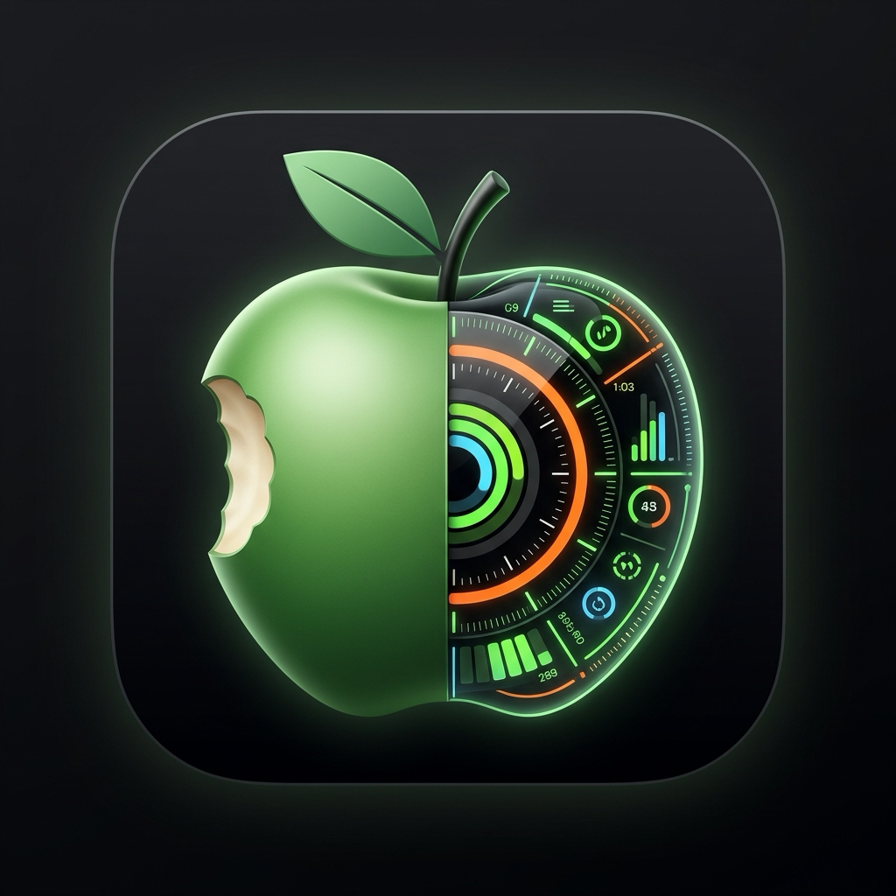
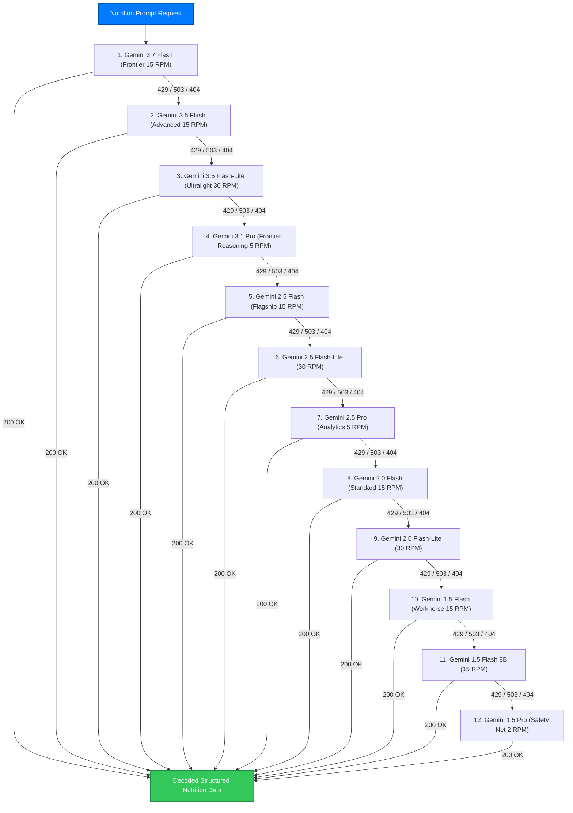

# 🍏 DIATROFIPROJECT

<p align="center">
  
</p>

<p align="center">
  <strong>Personal, Offline-First iOS Nutrition Rhythm, Athletic Supplementation, 4.0L Hydration, AutoSleep / Bevel Recovery & Energy Balance Assistant.</strong><br>
  <em>Tied dynamically to your training sessions and biological rhythms.</em>
</p>

<p align="center">
  
  
  
  
  
  
  
</p>

---

## 🎯 Executive Overview

**DIATROFIPROJECT** (also known as *The DIAτροφή Project* / code-named *Orchard*) is a production-grade, single-user, offline-first iOS application engineered for athletes who adhere to strict cyclical nutrition plans, heavy strength/athletic training schedules, and recovery protocols.

Most nutrition tracking apps fail because they are **static databases** that force you into rigid hourly slots. If your 18:00 training session shifts to 19:30, your pre-workout meal and post-workout protein window get desynchronized. 

DIATROFIPROJECT solves this with a **deterministic schedule dispatcher**:
* **Lego-Block Anchors:** Meals, supplements, and snacks are anchored relative to training (`afterTraining: 45m`, `beforeTraining: 90m`) or waking rhythm (`wake + 30m`). If your workout shifts, the entire day adjusts seamlessly without human intervention.
* **14-Day Cyclical Template Quotas:** A 7-day cyclical dietary rotation where every morning the user picks 1 of the 7 meal days, governed by a rolling 14-day quota window (each day can be selected up to 2 times every 2 weeks).
* **4.0 Liters/Day Hydration Engine:** Dedicated water & electrolyte tracking targeting 4,000 ml daily with quick-add chips (+250ml, +500ml, +1.0L, +Bolero 0 kcal powder), animated gradient fill, and Apple HealthKit `dietaryWater` sync.
* **AutoSleep & Bevel Recovery Parity:** Direct HealthKit integration reading deep, REM, core, and awake sleep stages from Apple Watch Ultra 3, rendering an interactive Hypnogram, Sleep Efficiency %, Restorative Sleep %, and a 0–100 Recovery Readiness Score.
* **Multi-Model Gemini Fallback Chain (12 Models):** A self-healing Bring-Your-Own-Key (BYOK) AI engine spanning Google Gemini 3.x, 2.5, 2.0, and 1.5 generations (Flash, Flash-Lite, and Pro) that automatically cascades upon rate limits (HTTP 429) or server overload (HTTP 503).
* **The Hero Apple Vector:** A visual end-of-day feedback mechanism where each meal confirmed takes a physical bite out of a vector apple shape.

---

## 🏆 12 Premier Nutrition & Performance Features

Benchmarked against the world's leading athletic nutrition and recovery platforms (*MacroFactor, Cronometer, RP Diet Coach, Zero, Streaks, MyFitnessPal, Bevel*):

| # | Feature | Platform Parity | Engine / Module | Capabilities |
|---|---|---|---|---|
| **1** | **Dynamic TDEE Expenditure Engine** | *MacroFactor* | [`ExpenditureEngine.swift`](file:///Users/john_ak/antigarvity/Orchard/Domain/ExpenditureEngine.swift) | Ordinary Least Squares (OLS) regression over calendar dates & EMA trend weight to calculate true daily metabolic burn ($7,700\text{ kcal/kg}$). |
| **2** | **Micronutrient & Electrolyte RDA Engine** | *Cronometer* | [`MicronutrientEngine.swift`](file:///Users/john_ak/antigarvity/Orchard/Domain/MicronutrientEngine.swift) | Athletic RDA targets for Sodium (3,500mg), Potassium (3,800mg), Magnesium (450mg), Calcium, Fiber (38g), and a 0–100% electrolyte replenishment ring. |
| **3** | **Smart Weekly Coaching Check-In** | *RP Diet Coach* | [`CoachingCheckInEngine.swift`](file:///Users/john_ak/antigarvity/Orchard/Domain/CoachingCheckInEngine.swift) | Algorithmic coach checking compliance (>75%), preserving protein at $2.2\text{ g/kg}$, and shifting carbs (70%) and fats (30%) dynamically. |
| **4** | **Intermittent Fasting & Circadian Clock** | *Zero / YAZIO* | [`FastingEngine.swift`](file:///Users/john_ak/antigarvity/Orchard/Domain/FastingEngine.swift) | Real-time biological stages: Digestion (0–4h) ➔ Fat Burning (4–12h) ➔ Ketosis & AMPK (12–16h) ➔ Autophagy (16h+). |
| **5** | **Multi-Goal Habit & Adherence Streak Rings** | *Streaks / Carbon* | [`HabitStreakEngine.swift`](file:///Users/john_ak/antigarvity/Orchard/Domain/HabitStreakEngine.swift) | 4 athletic rings: Nutrition, 4.0L Water, Sleep (>=7h / score >=75), and Supplements with perfect-day streak tracking. |
| **6** | **Staple Foods & Barcode Lookup Library** | *Cronometer / MFP* | [`StapleFoodLibrary.swift`](file:///Users/john_ak/antigarvity/Orchard/Domain/StapleFoodLibrary.swift) | Zero-latency offline bodybuilding pantry (chicken breast, egg whites, whey isolate, oats, cream of rice, salmon, EVOO) + barcode scanning. |
| **7** | **Peri-Workout Anabolic Window Tracker** | *RP Diet Coach* | [`PeriWorkoutEngine.swift`](file:///Users/john_ak/antigarvity/Orchard/Domain/PeriWorkoutEngine.swift) | Biphasic nutrient timing: Pre-workout fuel (60–90m), Intra-workout hydration, Immediate post-workout anabolic window (0–45m), and Solid meal. |
| **8** | **Custom Recipe & Macro Combo Builder** | *MyFitnessPal* | [`RecipeBuilderEngine.swift`](file:///Users/john_ak/antigarvity/Orchard/Domain/RecipeBuilderEngine.swift) | Combine pantry staples into custom recipes (e.g. "Power Proats"), compute aggregate & per-serving macros, and convert directly into scheduled plan items. |
| **9** | **Satiety, Energy & GI Digestion Journal** | *Lifesum* | [`DigestiveTracker.swift`](file:///Users/john_ak/antigarvity/Orchard/Domain/DigestiveTracker.swift) | Postprandial tracking: Satiety score (1–5), Energy level (1–5 food coma to peak), GI symptoms (bloating, acid reflux, heavy stomach), and digestive wellness score. |
| **10** | **Workout Strain vs Glycogen Fueling Score** | *Bevel / Whoop* | [`WorkoutFuelEngine.swift`](file:///Users/john_ak/antigarvity/Orchard/Domain/WorkoutFuelEngine.swift) | Compares Apple Watch workout energy burn with peri-workout carbohydrate intake, estimating glycogen adequacy ($65\%$ expenditure ratio). |
| **11** | **Goal Weight Projection & Deficit Curve** | *MacroFactor* | [`WeightProjectionEngine.swift`](file:///Users/john_ak/antigarvity/Orchard/Domain/WeightProjectionEngine.swift) | Mathematical milestone timeline, target completion date, and ISSN safe rate-of-loss guardrail ($< 1.0\%$ bodyweight/week). |
| **12** | **Deep Biometric & Coach Report Exporter** | *Cronometer Pro* | [`ReportExportEngine.swift`](file:///Users/john_ak/antigarvity/Orchard/Domain/ReportExportEngine.swift) | Generates standard RFC 4180 CSV tables and structured Greek briefings for athletic prep coaches with a single tap. |

---

## 🏛️ Architecture & Core Principles

```
                                  ┌────────────────────────────────┐
                                  │   The 50/50 Architectural Rule │
                                  └────────────────────────────────┘

    ┌───────────────────────────┐                       ┌───────────────────────────┐
    │     Deterministic Core    │                       │     AI Assistant Layer    │
    │        (The Clock)        │                       │       (The Assistant)     │
    ├───────────────────────────┤                       ├───────────────────────────┤
    │ • ScheduleResolver        │                       │ • GeminiBYOK 12-Model Chain│
    │ • NotificationPlanner     │      Validation       │ • Apple On-Device Model   │
    │ • CalorieEngine & Macros  │ ◄───────────────────  │ • Natural Language Food   │
    │ • 14-Day Quota Tracker    │   4P + 4C + 9F Rules  │ • Structured JSON Output  │
    │ • 100% Offline Swift Code │                       │ • Zero-Mock in Production │
    └───────────────────────────┘                       └───────────────────────────┘
                  │                                                   │
                  ▼                                                   ▼
    ┌───────────────────────────────────────────────────────────────────────────────┐
    │   User Confirmation Sheet ➔ SwiftData Store ➔ Idempotent HealthKit Sync       │
    └───────────────────────────────────────────────────────────────────────────────┘
```

### 1. The 50/50 Rule: Deterministic Clock vs. Generative Assistant
The application enforces an uncompromising boundary:
$$\text{AI Proposes} \longrightarrow \text{Deterministic Validator Checks} \longrightarrow \text{User Confirms} \longrightarrow \text{Persisted}$$

* **The Clock:** The deterministic engine is the ultimate source of truth. Schedule calculation, macro arithmetic ($4P + 4C + 9F \approx \text{kcal}$), notification triggers, and streak tracking run offline in pure Swift. If AI is toggled off, 100% of the app remains fully functional.
* **The Assistant:** When AI is used (food estimation, plan parsing), outputs are parsed into strictly typed Swift structs, checked against deterministic sanity limits, and presented for user approval before touching local persistence.

### 2. Pure Domain Isolation (Zero-Dependency)
The `Domain/` module imports **neither UIKit, SwiftUI, HealthKit, nor UserNotifications**. It compiles with zero external framework dependencies:
* `ScheduleResolver.swift`: Pure function mapping `(Date, Plan, DayTemplateKey) -> [ScheduledEvent]`.
* `NotificationPlanner.swift`: Pure function mapping `(Events, LogEntries, Date, Settings) -> [NotificationSpec]`.
* `CalorieEngine.swift`: Pure math calculating basal proration, training burn, dietary intake, and surplus/deficit balance.
* `AppleProgress.swift`: Calculates meal slice states (`pending`, `eaten`, `skipped`, `overdue`) and interactive apple vector completion.

---

## ⚡ Key Feature Highlights

### 🤖 Gemini BYOK Multi-Model Fallback Chain (12 Models)
Users provide their personal Google AI Studio API key (stored securely in Apple's device Keychain via `kSecClassGenericPassword`). To eliminate downtime from Free Tier quotas (15–30 RPM), `GeminiLLMProvider` implements a resilient 12-model fallback cascade:



* **Fast-Fail on Auth:** If the API key is invalid (`HTTP 400 API_KEY_INVALID` or `HTTP 403 PERMISSION_DENIED`), execution aborts on the 1st attempt to prevent useless requests.
* **Preferred Starting Model:** Users can select any model (e.g. `gemini-3.7-flash` or `gemini-2.5-pro`) as their preferred primary in Settings, keeping the remaining 11 models as an automatic safety net.
* **Built-in Latency Diagnostic:** Real-time ping test in Settings reporting connection health, latency in ms, and fallback detection.

### 😴 AutoSleep & Bevel Recovery Architecture
* **Apple Watch Ultra 3 Integration:** Queries `HKCategoryTypeIdentifier.sleepAnalysis` samples across the night.
* **Stage Segmentation:** Automatically calculates duration and percentages for:
  * **Deep Sleep** (Physical tissue restoration & growth hormone)
  * **REM Sleep** (Cognitive consolidation & mental recovery)
  * **Core / Light Sleep**
  * **Awake Periods**
* **Readiness & Debt Scoring:** Computes a composite **0–100 Recovery Score** based on restorative sleep percentage (Deep + REM), total sleep duration against the 8.0-hour baseline, and cumulative sleep debt.

### 💊 Athletic Supplement Stacking & Zero-Calorie Flavoring
One-tap rapid logging configured for serious athletic performance:
* **Creatine Monohydrate (5g)** — 0 kcal, 0g macros
* **Whey Protein (30g)** — 120 kcal, 25g Protein, 2g Carbs, 1g Fat
* **Multivitamin & Omega-3** — 0 kcal
* **Electrolytes & Magnesium** — 0 kcal
* **Bolero Water Powder** — 0 kcal hydration flavoring chip

### 💧 4.0 Liters/Day Hydration Engine (`HydrationDay`)
Athletic performance and muscle fullness demand disciplined fluid balance:
* **Strict 4,000 ml Target:** Designed specifically for high-intensity training regimens.
* **Quick-Add Interactive Chips:** One-tap haptic buttons for `+250 ml` (glass), `+500 ml` (shaker), `+1.0 L` (bottle), and `Bolero 💧` (flavoring packet, 500ml 0 kcal).
* **Smooth Spring Progress Bar:** Animated gradient fill displaying remaining milliliters and percent completion.
* **HealthKit Integration:** Writes intake samples directly to `HKQuantityTypeIdentifier.dietaryWater`.

### 🛡️ 7-Day Free Provisioning Certificate Guard (`SigningGuard`)
For developers deploying via personal Apple ID without a paid Developer Account ($99/year), iOS enforces a strict 7-day expiration policy on provisioning profiles.
* Parses `embedded.mobileprovision` directly using an ASN.1 / XML plist extractor.
* Dynamically calculates exact hours remaining until certificate expiration.
* Schedules local notifications at $T-24\text{h}$ and $T-2\text{h}$ warning the user to reconnect to Xcode and re-sign (`Cmd + R`), preventing unexpected app crashes.

---

## 📂 Repository Structure

```
The-DIAtrofi-Project/
├── App/
│   ├── OrchardApp.swift             # App entry point & Notification delegate setup
│   └── AppContainer.swift           # Central ObservableObject, 14-day quota tracker
├── Domain/                          # Pure Swift Domain Layer (Zero Framework Imports)
│   ├── Models/                      # Plan, DayTemplate, PlanItem, Anchor, LogEntry, SleepEntry
│   ├── ScheduleResolver.swift       # Deterministic schedule resolution & Lego ripples
│   ├── NotificationPlanner.swift    # Pure local notification schedule generation
│   ├── CalorieEngine.swift          # Dynamic energy balance, basal proration, training burn
│   ├── AppleProgress.swift          # Interactive vector apple bite state calculations
│   ├── WeeklyStats.swift            # Adherence, macro compliance, sleep correlation
│   └── Validators/                  # Strict deterministic validation rules (4P+4C+9F)
├── Features/                        # SwiftUI Feature Modules
│   ├── Today/                       # Hero Apple, 8-chip day template picker, active banner
│   ├── Log/                         # Manual & rapid athletic supplement logging
│   ├── Sleep/                       # AutoSleep/Bevel hypnogram & recovery gauge
│   ├── Insights/                    # Weekly macro adherence, calorie balance charts
│   └── Settings/                    # Signing guard, HealthKit sync, Gemini BYOK UI
├── Services/                        # Infrastructure Adapters Behind Protocols
│   ├── AI/                          # GeminiLLMProvider (12-model chain), LLMRouter, KeychainStore
│   ├── Health/                      # Real HealthKitStore & Test Fakes
│   ├── Notifications/               # LocalNotificationService & category actions
│   ├── Persistence/                 # Local JSON Plan Loader & SwiftData stack
│   ├── Security/                    # SigningGuard (embedded.mobileprovision parser)
│   └── Telemetry/                   # Zero-knowledge local JSONL telemetry & rotation
├── DesignSystem/                    # Color palette, vector AppleShape, typography, haptics
├── Resources/                       # Assets, Localizable.xcstrings, plan.sample.json
├── Tests/OrchardTests/              # 94 Automated Tests & 7 Live Smoke Test Scenarios
│   ├── LiveSmokeTests.swift         # End-to-end user rhythm & wearable test scenarios
│   ├── GeminiFallbackChainTests.swift # Mock URLProtocol testing all 12 fallback models
│   ├── PlanModelTests.swift         # Nutrition, macro math, and 7-day cyclical tests
│   └── CalorieEngineTests.swift     # Basal proration & HealthKit sync tests
└── project.yml                      # XcodeGen specification (reproducible .xcodeproj)
```

---

## 🧪 Verification & Test Suite

The DIAτροφή Project features a comprehensive test suite executed with strict Swift concurrency checking:

```bash
DEVELOPER_DIR=/Applications/Xcode.app/Contents/Developer swift test
```

### Test Suite Metrics:
* **Total Executed Tests:** **94**
* **Passed:** **94 (100%)**
* **Failed:** **0**
* **Suite Execution Time:** **0.039 seconds**

### Verified End-to-End Scenarios (`LiveSmokeTests.swift`):
1. **Scenario 1:** Real 7-day cyclical schedule resolution, morning wake rhythm & mid-week template switching.
2. **Scenario 2:** Workout delay ripple (shifting 75-min workout shifts post-workout meal preserving 30–90m gap).
3. **Scenario 3:** Escalating lock-screen meal reminders with snooze and skip cancellation.
4. **Scenario 4:** Calorie surplus/deficit calculation with idempotent HealthKit writes (`orchard.<uuid>`).
5. **Scenario 5:** Provisioning profile ASN.1 parsing and T-24h / T-2h warning alerts.
6. **Scenario 6:** AutoSleep & Bevel sleep stage hypnogram parsing, restorative ratio & recovery readiness score.
7. **Scenario 7:** Athletic supplement logging (Whey, Creatine, Bolero) and Zero-Mock production LLMRouter contract.

---

## 🔒 Privacy & Open Source Safety

* **Personal Diet Confidentiality:** Real dietary configurations (`plan.json` and `Resources/plan.json`) are strictly protected in `.gitignore`. The repository includes a clean, sanitized template: [`Resources/plan.sample.json`](Resources/plan.sample.json).
* **Zero Hardcoded Secrets:** No API keys, credentials, or personal access tokens are stored in the git history or codebase. Gemini keys are entered at runtime and stored in Apple's device Keychain.
* **Apple Watch Health Safety:** Dietary calories are written idempotently (`HKMetadataKeySyncIdentifier = "orchard.<uuid>"`). Active energy burned is strictly read-only to avoid duplicate counting against Apple Watch Ultra 3 telemetry.
* **Zero-Knowledge Local Telemetry:** Telemetry is written locally to `Application Support/Orchard/telemetry.jsonl` with automatic 1,000-event rotation and one-tap in-app export / clear tools. No data ever leaves the device.

---

## 🚀 Quickstart & Installation

### Prerequisites
* macOS Sonoma (14.0+) or newer
* Xcode 16.0+
* [XcodeGen](https://github.com/yonaskolb/XcodeGen) (`brew install xcodegen`)

### 1. Clone & Setup
```bash
git clone https://github.com/train-cell/The-DIAtrofi-Project.git
cd The-DIAtrofi-Project
```

### 2. Configure Your Personal Nutrition Plan
Copy the sample plan to create your personal diet configuration:
```bash
cp Resources/plan.sample.json Resources/plan.json
cp Resources/plan.sample.json plan.json
```
*(Edit `Resources/plan.json` with your real meal items, macros, and training anchors).*

### 3. Generate Xcode Project & Run Tests
```bash
xcodegen generate
swift test
```

### 4. Deploy to Physical iPhone
```bash
open Orchard.xcodeproj
```
1. Select target **Orchard** $\rightarrow$ **Signing & Capabilities**.
2. Select your **Personal Team** (Free Apple ID certificate).
3. Connect your iPhone and press **`Cmd + R`**.

---

## 📜 License

This project is open-source under the terms of the [MIT License](LICENSE).

---

<p align="center">
  Crafted with precision by <strong><a href="https://github.com/train-cell">John Akrivos</a></strong>.
</p>
